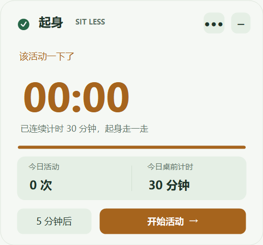
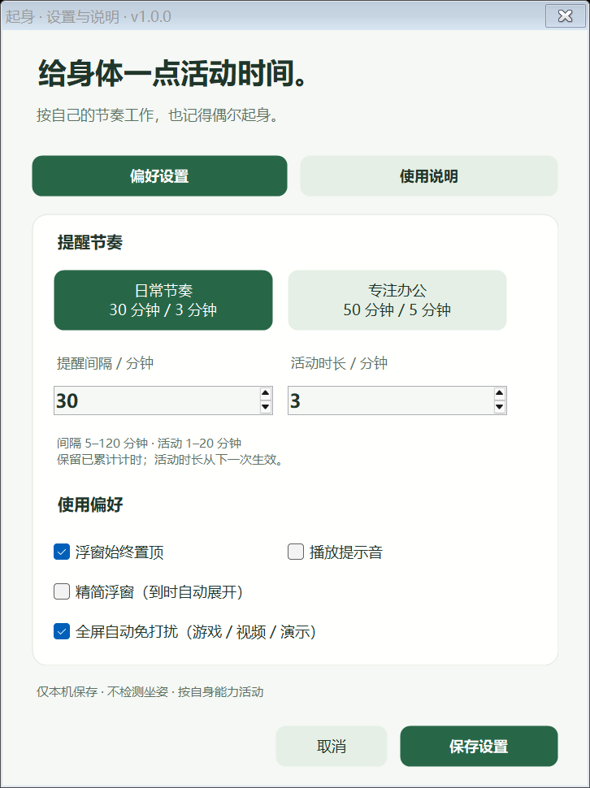

# 起身 · Sit Less

轻量的 Windows 久坐提醒工具，以可拖动的置顶浮窗显示倒计时。使用 Windows 原生窗体，无需安装、登录或联网，无第三方依赖。


## 直接使用

正式版本 **v1.0.0** 包含新版浮窗、按钮黑角修复和全屏自动免打扰。

下载 [Windows 便携版压缩包](https://github.com/Haorain-Li/sitless-windows/releases/download/v1.0.0/SitLess-Windows-v1.0.0.zip)，解压到可写文件夹，双击 **SitLess.exe**。

也可直接下载 [SitLess.exe](https://github.com/Haorain-Li/sitless-windows/releases/download/v1.0.0/SitLess.exe)。适用于 Windows 10/11，使用系统自带 .NET Framework 4.x，建议 4.8。

[完整 Release 与更新说明](https://github.com/Haorain-Li/sitless-windows/releases/tag/v1.0.0) · [SHA-256 校验值](https://github.com/Haorain-Li/sitless-windows/releases/download/v1.0.0/SHA256SUMS.txt)。更新前请从托盘退出旧程序；设置标题应显示 **v1.0.0**。仓库 `portable/` 也提供相同的正式版文件。

## 功能

- 默认每 **30 分钟提醒**，活动计时 **3 分钟**；提供 30/3、50/5 两种预设及自定义时长。
- 可拖动、置顶、暂停、切换精简模式，或收起到系统托盘。
- 到时保持提醒，手动开始活动；可延后 5 分钟，保留已累计的桌前计时。
- 中断活动不计完成次数；活动计时完成后等待你手动继续下一轮。
- 锁屏、休眠暂停计时，不根据键鼠空闲推断起身。
- 设置与当天统计仅保存到程序旁的 `sitless.settings.xml`，不上传数据。
- 新版浮窗突出倒计时，分栏显示今日活动次数与桌前计时；按钮提供悬停、按下和键盘焦点反馈。
- 设置分成“偏好设置”和“使用说明”，预设随当前时长高亮；保存提示音等偏好不会打断已延后的提醒。
- 窗口获得焦点时支持 `Ctrl+,` 打开设置、`Ctrl+M` 切换精简浮窗、`Ctrl+P` 暂停 / 继续，`Esc` 收起到托盘。
- 默认全屏自动免打扰：隐藏浮窗、屏蔽提示音与气泡，继续计时；退出全屏稳定约 3 秒后恢复，仅补发仍有效的一次提醒。覆盖独占 Direct3D 与无边框全屏，视频 / 演示同样适用，可在设置和托盘关闭。




## 规则依据

WHO 将久坐行为定义为清醒时坐着、斜倚或躺卧，能量消耗不超过 1.5 METs 的行为，并未给出适用于所有成年人的统一连续久坐时限。

- **30 分钟提醒**参考 Mayo Clinic 定期短暂中断坐姿的建议。
- **3 分钟活动**是便于执行的可调产品预设，不是医学界定。
- **50/5 办公预设**参考英国 HSE 对屏幕工作的建议：连续工作约 50–60 分钟后，安排 5–10 分钟短休息。

工具只记录计时，不识别身体姿态；完成活动计时不代表检测到实际站立或运动。请按自身能力走动、舒展或改变姿势。

来源：[WHO 建议](https://www.ncbi.nlm.nih.gov/books/NBK566046/) · [WHO 术语](https://www.ncbi.nlm.nih.gov/sites/books/NBK566047/) · [Mayo Clinic](https://www.mayoclinic.org/healthy-lifestyle/adult-health/expert-answers/sitting/faq-20058005) · [HSE](https://www.hse.gov.uk/contact/faqs/vdubreaks.htm)

## 占用与验证

正式版可执行文件约 **47 KB**，继续使用系统原生窗体，没有增加第三方依赖。早期源码快照的资源采样与当前验证范围见 [验证说明](验证说明.md)；历史内存读数不代表正式版实测。

计时引擎的 **71 项断言通过**，涵盖到时提醒、延后、暂停、完整与中断活动、修改时长、跨天、睡眠间隔及统计恢复，并补充保存设置时保留延后的回归验证。详细说明见 [验证说明](验证说明.md)。

另有 **144 项按钮绘制断言通过**，直接从黑色缓冲区执行按钮绘制，覆盖两种容器背景、三种缩放与六种状态，避免仅靠静态预览遗漏真实重绘时的黑角。

**53 项全屏免打扰断言通过**，包括多显示器坐标、最大化与普通窗口排除、短暂切屏、检测未知、退出延迟、手动暂停保留、旧设置迁移及通知延后。原生检测接口只读调用成功，尚未在实际游戏中验收。后续建议及实机验收步骤见 [优化方案清单](优化方案清单.md)。

## 从源码构建

在 Windows PowerShell 中运行：

```powershell
.\build.ps1

# 程序占用旧文件时，构建到独立目录
.\build.ps1 -OutputDirectory dist\custom

# 构建、运行全部检查并生成便携包与校验值
.\package.ps1
```

构建脚本调用 Windows 自带的 .NET Framework C# 编译器，生成 `dist/SitLess.exe` 并运行全部 268 项断言，不需要下载依赖。打包脚本默认输出到 `dist/release/`，不包含用户设置和测试程序。

```powershell
# 快速体验：10 秒提醒、5 秒活动，不保存设置
.\dist\SitLess.exe --demo

# 生成界面预览
.\dist\SitLess.exe --render

# 指定预览缩放（仅 --render 有效，支持 0.75–3）
.\dist\SitLess.exe --render --render-scale=1.5
```

预览保存在可执行文件旁的 `previews/`，包含正常、键盘焦点、暂停、精简、提醒、活动、完成、偏好设置和使用说明九种画面；不保存演示计时数据。

源码：[App.cs](App.cs)（浮窗、设置与本机存储）、[TimerEngine.cs](TimerEngine.cs)（计时逻辑）、[TimerEngineTests.cs](TimerEngineTests.cs)（计时验证）。



完整操作说明见 [使用说明](使用说明.md)。
