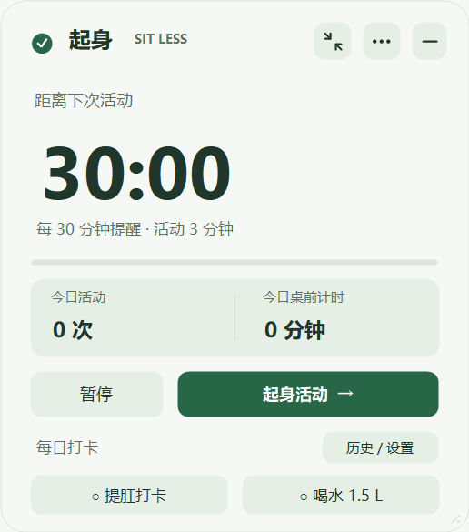
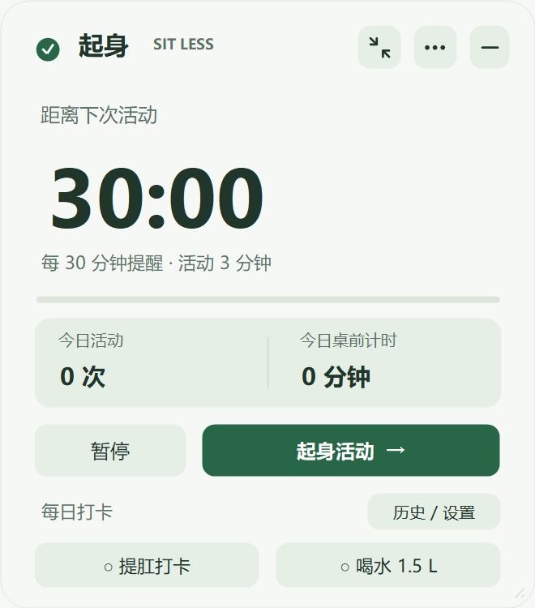
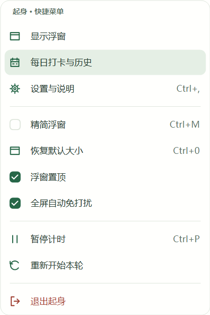

# 起身 · Sit Less

一个轻量的 Windows 桌面提醒工具：定时起身活动，记录每日提肛与喝水打卡，在全屏游戏时安静等待。

使用原生 Windows 窗体，无需安装或登录，无第三方依赖。设置与记录保存在本机。

[使用指南](docs/使用说明.md) · [文档目录](docs/README.md) · [更新记录](CHANGELOG.md) · [下载 v1.3.0](https://github.com/Haorain-Li/sitless-windows/releases/tag/v1.3.0)



## 版本与下载

| 版本 | 状态 | 包含内容 |
| --- | --- | --- |
| **v1.3.0** | 当前版本 | 灰框修复、自启动、固定数据目录、打卡日历及既有提醒功能 |
| **v1.0.0** | 历史版本 | 久坐提醒、全屏免打扰及按钮绘制修复；不含后续每日打卡与拖动缩放 |

下载 [v1.3.0 便携包（含使用文档）](https://github.com/Haorain-Li/sitless-windows/releases/download/v1.3.0/SitLess-Windows-v1.3.0.zip)，或 [单文件程序](https://github.com/Haorain-Li/sitless-windows/releases/download/v1.3.0/SitLess.exe)。[SHA-256 校验值](https://github.com/Haorain-Li/sitless-windows/releases/download/v1.3.0/SHA256SUMS.txt)与下载文件一同提供。源码构建方法见下文。

适用于 Windows 10 / 11，使用系统自带 .NET Framework 4.x，建议 4.8。解压到可写文件夹，双击 `SitLess.exe` 即可运行。

## 主要功能

| 功能 | 使用方式 |
| --- | --- |
| 久坐提醒 | 默认每 30 分钟提醒，活动计时 3 分钟；支持 30/3、50/5 预设及自定义 |
| 自由调整浮窗 | 拖动背景移动，拖动边缘或四角调整大小；文字与按钮随尺寸适配 |
| 两种浮窗 | 右上角双箭头一键精简 / 展开，两种模式分别记住大小 |
| 快捷菜单 | 三个点打开分组菜单，直接操作设置、打卡、置顶、暂停及尺寸还原 |
| 全屏免打扰 | 全屏游戏、视频或演示时隐藏浮窗并静音；退出后仅恢复仍有效的提醒 |
| 每日打卡 | 提肛与喝水分别确认，可撤销；次日刷新，以月历查看历史和累计次数 |
| 每日提醒 | 默认 20:00 合并提醒未完成的打卡，可调时间及分别关闭 |
| 自启动 | 默认开启随 Windows 登录启动，设置里可关闭，自动启动时收起到托盘 |
| 本地保存 | 固定保存在当前 Windows 用户目录，升级或移动软件后保留设置与打卡历史 |

活动计时由用户主动开始，提前结束不记完成次数，完整结束后等待手动继续。锁屏和休眠期间暂停久坐计时。工具不检测坐姿、实际饮水量或训练动作；每日打卡表示用户自行确认。

饮水目标支持个人设置。参考值的适用条件、提肛计划及资料来源见 [健康提醒设计与依据](docs/健康提醒功能设计方案.md)。

## 调整浮窗大小

1. 将鼠标移到浮窗任一边缘或四角，光标变化后按住左键拖动。
2. 普通与精简模式分别保存宽高，切换模式或重启后恢复。
3. 需要还原时，在三个点菜单选择“恢复默认大小”，或按 `Ctrl+0`，仅还原当前模式。

窗口有最小尺寸，避免内容被挤掉；最大尺寸受屏幕工作区限制。到时提醒或活动完成时仍会临时展开，处理后恢复原先的精简尺寸。调整尺寸不影响计时和打卡。

<details>
<summary>查看调整大小、精简模式与菜单</summary>






</details>

## 日常操作

| 操作 | 方法 |
| --- | --- |
| 移动浮窗 | 拖动背景或文字 |
| 暂停 / 继续 | 主界面按钮或 `Ctrl+P` |
| 精简 / 展开 | 右上角双箭头或 `Ctrl+M` |
| 恢复默认大小 | 菜单入口或 `Ctrl+0` |
| 打开设置 | 三个点菜单或 `Ctrl+,` |
| 收起到托盘 | 右上角减号或 `Esc`；双击托盘图标恢复 |
| 查看每日打卡 | 普通浮窗“历史 / 设置”，或托盘“每日打卡与历史” |
| 退出程序 | 三个点或托盘菜单中的“退出起身” |

快捷键仅在浮窗获得焦点时生效。软件退出期间不会提醒。完整规则见 [使用指南](docs/使用说明.md)。

## 保存数据与升级

从 v1.3.0 起，数据固定保存在 **`%LOCALAPPDATA%\SitLess`**。`sitless.settings.xml` 保存偏好、窗口位置 / 尺寸与当天计时，`sitless.checkins.xml` 保存打卡历史，均维护备份。每个 Windows 用户有自己的记录；同一账号下移动或升级程序无需再复制记录。

升级前先从托盘退出旧版。首次正常运行会迁移新程序所在目录中的旧 XML，保留原件。旧记录在其他文件夹时，可在“历史记录”页点击“导入旧版记录”，选择旧的 `sitless.checkins.xml`。导入补充缺失日期与今日空白状态，不覆盖已确认记录。若旧版仍在运行，新程序会切回旧实例，请核对设置标题中的版本。

日历可切换月份，点击日期查看当日目标与提肛 / 喝水确认情况；绿色标记表示已确认，浅色表示未确认，无标记表示没有记录。历史日期只读。

## 随 Windows 启动

默认在首次正常运行时注册当前用户的登录启动项。在“设置 → 偏好设置”中，勾选或取消“随 Windows 登录启动”并保存即可更改；失败时会显示提示，允许重试。自动启动时收起到托盘。

移动程序后手动运行一次，以更新启动路径。Windows 的系统启动项策略仍然有效。演示、预览和自动测试不会修改真实启动项。

这些私人数据已排除在 Git 和分发包之外。保存失败的处理方式见 [使用指南](docs/使用说明.md)。

## 从源码构建

在 Windows PowerShell 中进入项目目录，选择运行：

```powershell
# 构建程序并执行全部检查，输出到 dist/
.\build.ps1

# 或构建、检查并打包，输出到 dist/release/
.\package.ps1
```

使用 Windows 自带的 .NET Framework C# 编译器，无需下载 NuGet 包或额外安装 .NET SDK。旧文件被占用时，可指定独立目录：

```powershell
.\package.ps1 -OutputDirectory dist\custom
```

当前检查共 **2,558 项断言**：原有 1,031 项，加上 1,527 项数据迁移、启动项、日历与健壮性检查。当前灰框修复的代码路径与进程内回归已检查；真实点击、登录启动、实际游戏与混合 DPI 仍需实机验收，范围见 [验证说明](docs/验证说明.md)。

演示、界面预览、源码结构与分发清单见 [开发说明](docs/开发说明.md)。演示和预览不写入个人记录。

## 文档

- [使用指南](docs/使用说明.md)：提醒规则、打卡、缩放、数据与快捷键。
- [开发说明](docs/开发说明.md)：构建、测试、预览、源码与分发。
- [验证说明](docs/验证说明.md)：当前版本已完成的检查及待验收范围。
- [代码审查与健壮性报告](docs/代码审查与健壮性报告.md)：发现的问题、修复与故障注入检查。
- [健康提醒设计与依据](docs/健康提醒功能设计方案.md)：饮水参考、提肛打卡及适用条件。
- [优化路线](docs/优化方案清单.md)：后续优先级与验收标准。
- [更新记录](CHANGELOG.md)：当前版本演进；早期开发记录保存在 `docs/archive/`。
